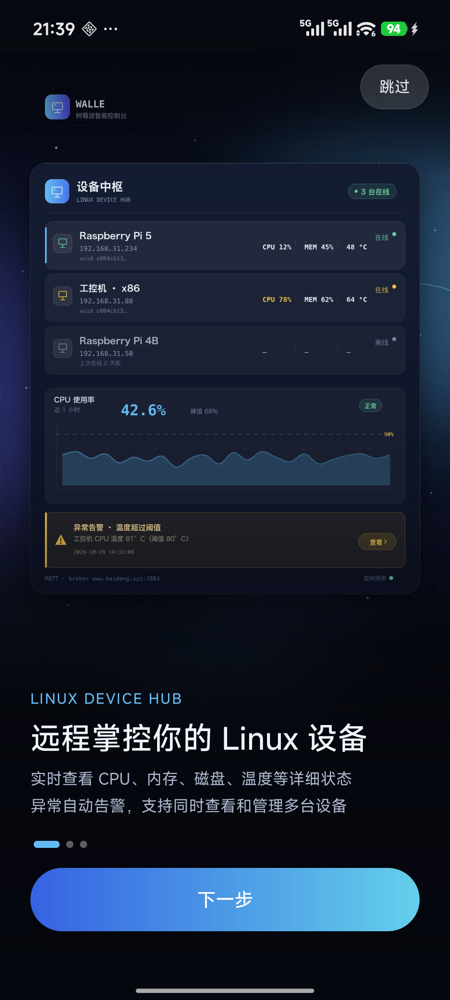
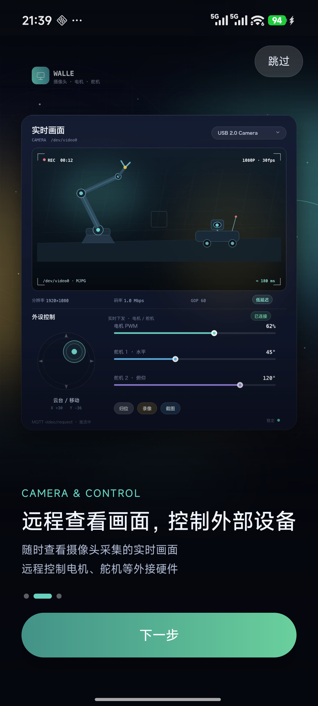
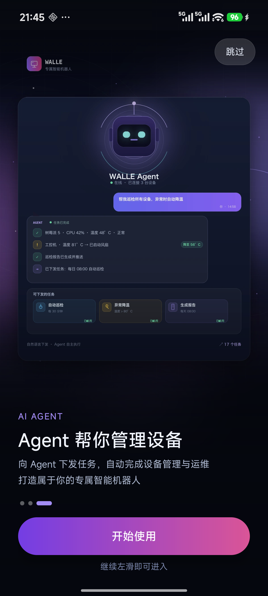

<div align="center">

# 树莓派控制器 · walle

**用手机远程监控与操控 Linux / 树莓派设备的 Android 客户端**


</div>

---

## 项目简介

`walle` 是一个基于 **MQTT** 的 Android 设备面板：手机连上 MQTT Broker 后，可以发现局域网/公网上的树莓派等 Linux 设备，实时查看 CPU、内存、磁盘、网络、温度等运行状态，接收异常告警，远程执行 shell 命令，并通过 **WebRTC（WHEP）** 观看设备端摄像头的实时画面。

App 只负责「看」和「控制」，设备端由配套的 Python 监控脚本（仓库外）负责采集与执行，两端通过一组约定好的 MQTT 主题交互。

```
┌──────────────────┐      MQTT 主题 / JSON      ┌──────────────────┐
│   Android App    │ ◄────────────────────────► │   MQTT Broker    │
│  树莓派控制器      │                            │  Mosquitto 等    │
└────────┬─────────┘                            └────────┬─────────┘
         │ WHEP over HTTPS                               │ MQTT
         ▼                                               ▼
┌──────────────────┐      RTMP / RTSP 推流      ┌──────────────────┐
│  WHEP / 流媒体服务 │ ◄───────────────────────── │ 树莓派 / Linux 设备│
│  SRS、MediaMTX 等 │                            │ rpi_monitor.py   │
└──────────────────┘                            └──────────────────┘
```

---

## 功能特性

### 🗂 设备管理
- 自动发现同一 Broker 下的多台设备，在线优先排序，顶部展示「已发现 N 台（在线 M）」
- 下拉刷新 / 手动重新扫描（广播查询，3 秒收敛窗口）
- 设备唯一标识以 `uuid` 为主键，设备重启换 `uuid` 时按 `device_id` 自动归并，不会产生幽灵卡片

### 📊 实时状态
- **系统**：设备型号、主机名、IP、系统 / 内核版本、已运行时长
- **CPU**：总使用率、温度、1/5/15 分钟负载、当前 / 最小 / 最大主频、逻辑与物理核心数、各核占用
- **内存**：使用率、已用 / 总量 / 可用、Swap
- **磁盘**：多挂载点逐个展示容量、使用率、文件系统类型
- **网络**：总入站 / 出站速率，各网卡 `↓rx / ↑tx`
- 手动查询 + 自动刷新（间隔可配），下拉刷新

### 🎮 视频控制
- 枚举设备端 v4l2 摄像头，展示支持的格式 / 分辨率 / 帧率
- 点击画面发起推流，运行中可切换摄像头（复用同一房间号，避免黑屏）
- 内嵌预览 + 全屏播放页（跟随重力左右横屏、沉浸式、保持常亮）
- WHEP 拉流：ICE 收集完成 → 发送 SDP Offer → 应用 Answer

### ⌨️ 远程命令
- 在设备上以 shell 执行任意命令，超时 1–300 秒可调
- 基于 `request_id` 的结果配对，避免多命令串台
- 8 条常用命令一键填入（`uptime`、`df -h`、`free -m`、`vcgencmd measure_temp` …）
- 本次会话命令历史（保留 20 条）
- 结果区分 `success / failed / timeout / denied / error` 并按状态着色

### 🔔 告警中心
- 接收设备告警、恢复、USB 接入 / 拔出事件
- 按级别（`critical / warning / info`）与事件类型配色
- 全局未读计数，底部导航「设置」tab 显示红点
- 一键清空

### ⚙️ 连接设置
- 服务器地址、端口、用户名、密码、`clientId`、自动重连、启动自动连接、状态刷新间隔
- 保存后自动重连；`clientId` 持久化避免被 Broker 互踢
- 前台服务保活 MQTT 长连接（常驻通知）

### 🚀 首次启动引导
- 3 屏全屏插图引导，支持左右滑动、指示点、跳过
- 第 3 屏继续左滑即进入主界面，结束后写入「已看过」标记
- 设置页「重看新手引导」随时回顾

---

## 界面预览

|                引导 1 · 设备中枢                 |               引导 2 · 画面与控制                |                  引导 3 · Agent                  |
|:------------------------------------------------:|:------------------------------------------------:|:------------------------------------------------:|
|  |  |  |

---

## MQTT 主题约定

**协议 v2（多租户主题）**：所有主题都在 `walle/{tenant}/{device}/` 下展开。

- `tenant` = App 登录用的 MQTT 用户名（清洗后），Broker 用 `walle/${username}/#` 做 ACL；
- `device` = 设备端稳定的 `device_id`（MAC + CPU + 内存的 md5 前 16 位，重启不变）；
- 所有报文均为 JSON，QoS 1，Keep Alive 60s；除发现广播外，请求必须带匹配的 `uuid`。

| 用途 | App → 设备（请求） | 设备 → App（应答） | 关键字段 |
|---|---|---|---|
| 设备发现 | `walle/{t}/discovery/query` | `walle/{t}/{d}/discovery/result` | 请求：`request_id`；应答：`request_id`、`uuid`、`device_id`、型号 / 系统 / IP / MAC … |
| 状态 | `walle/{t}/{d}/state/query` | `walle/{t}/{d}/state/result` | 请求：`uuid`、`request_id`；应答：`request_id`、`system`、`cpu`、`memory`、`disk`、`network` |
| 远程命令 | `walle/{t}/{d}/cmd/exec` | `walle/{t}/{d}/cmd/result` | 请求：`uuid`、`cmd`、`request_id`、`timeout`；应答：`request_id`、`status` |
| 摄像头能力 | `walle/{t}/{d}/camera/capability/query` | `walle/{t}/{d}/camera/capability/result` | 请求：`uuid`、`request_id`；应答：`request_id`、节点 / 格式 / 分辨率 / 帧率 |
| 开始推流 | `walle/{t}/{d}/video/start/request` | `walle/{t}/{d}/video/start/result` | `uuid`、`video_device`、`room_number`、`request_id` |
| 停止推流 | `walle/{t}/{d}/video/stop/request` | `walle/{t}/{d}/video/stop/result` | `uuid`、`room_number`、`request_id` |

**主动上报（不等查询，没有 `/result` 后缀）**：

| 主题 | 方向 | 说明 | 关键字段 |
|---|---|---|---|
| `walle/{t}/{d}/online` | 设备 → App | 上线 / 下线（retained + LWT 遗嘱） | `online`、`uuid`、`device_id`、`hostname` |
| `walle/{t}/{d}/alarm` | 设备 → App | 告警 / 恢复 / USB 插拔 | `level`、`event`、`metric` |

> **命名约定**：请求按语义划分 —— 查询用 `…/query`、命令用 `…/exec`、动作（推流）用 `…/request`；
> 应答一律 `…/result`，且**只在收到对应请求后发布**；只有 `online` 与 `alarm` 是设备主动上报。
>
> **配对约定**：每个请求都必须带 `request_id`（8 位十六进制），设备在对应 `…/result` 里**原样回显**；
> App 用它把结果和「哪一次请求」对上，迟到的旧结果直接丢弃。

推流成功后在 App 侧按 `room_number` 拼接 WHEP 地址拉流（`BuildConfig.WHEP_URL_TEMPLATE`）。

> 设备端实现与部署见 [`device/README.md`](device/README.md)。

---

## 快速开始

### 环境要求

| 项 | 版本 |
|---|---|
| Android Studio | 2026.2 及以上（支持 AGP 9.x） |
| JDK | 17（Studio 自带 JBR 21 亦可） |
| Android SDK | Platform 36、Build-Tools 36.0.0 |
| AGP / Gradle | 9.4.1 / 9.6.0（见 `build.gradle` 与 `gradle/wrapper/gradle-wrapper.properties`） |
| 运行设备 | Android 8.0（API 26）及以上（targetSdk 36，已按 edge-to-edge 适配） |

### 构建

用 Android Studio 打开项目根目录，等待 Gradle Sync 后直接 Run；或命令行：

```bash
# 按需覆盖默认 Broker 地址（优先级：-P 参数 > 环境变量 > 默认值）
./gradlew :app:assembleDebug \
  -PmqttHost=192.168.1.10 \
  -PmqttPort=8883          # 默认就是 8883（TLS）；改用 1883 明文时 TLS 开关会自动关闭

# release APK（R8 混淆 + 资源压缩）
./gradlew :app:assembleRelease

# 发布到 Play（按 ABI / 语言 / 密度拆包，单机只下载自己那套 .so）
./gradlew :app:bundleRelease
```

> 已配置 ABI 过滤：只打 `arm64-v8a` + `armeabi-v7a`（WebRTC `.so` 从 41 MB 降到 17.3 MB）。
> 如果你的模拟器是 **x86_64** 镜像，需要在 `app/build.gradle` 的 `ndk { abiFilters ... }` 里临时加回 `'x86_64'`；
> arm64 镜像（Apple Silicon 上的模拟器）则无需改动。

> 已提交 `gradlew` / `gradlew.bat` 与 wrapper jar，首次构建会自动下载 Gradle 9.6.0。

### 配置 Broker

**Broker 地址/端口**可在构建期通过 `buildConfigField` 注入（仅这两个参数，代码库中不含任何账号口令）：

| 方式 | 示例 |
|---|---|
| `gradle.properties` | `mqttHost=www.baidong.xyz` |
| 命令行参数 | `-PmqttHost=192.168.1.10 -PmqttPort=8883` |
| 环境变量 | `MQTT_DEFAULT_HOST`、`MQTT_DEFAULT_PORT` |

**用户名/密码不提供默认值**：首次启动时在 App 的「设置 → 服务器连接」里输入，随后由 Android Keystore 加密保存在本地（旧版本遗留的明文凭据会自动迁移并删除）。无凭据时不会建立 MQTT 连接，也不会驻留前台通知。

**TLS 默认开启**：默认端口就是 `8883`，新装默认走 `ssl://`。设置页的「启用 TLS 加密 (ssl://)」开关决定 URI 是 `ssl://` 还是 `tcp://`；保存时按端口自动纠正（8883/8084/8884 → 开启，1883/8083 → 关闭），避免「端口改了但协议没换」。EMQX 默认端口对应关系：

| 端口 | 协议 | 说明 |
|---|---|---|
| 1883 | `tcp://` | 明文，需关闭 TLS 开关 |
| 8883 | `ssl://` | TLS，需开启 TLS 开关 |
| 8083 | `ws://` | WebSocket，明文 |
| 8084 | `wss://` | WebSocket + TLS |

### 证书

App **不内置任何证书**，全部依赖 Android 系统信任库：

- **MQTT（8883）** 与 **WHEP（443）** 都要求服务端使用公共 CA 签发的证书（例如 TrustAsia / Let's Encrypt），且证书 SAN 必须包含你在 App 里填写的域名。
- 私有 CA / 自签证书：把 CA 证书放进 `app/src/main/res/raw/`，在 `res/xml/network_security_config.xml` 加 `domain-config` + `trust-anchors`（**只信任该域名**），不要用「信任所有证书」的写法。
- Debug 构建额外信任「用户安装的 CA」（见 `network_security_config.xml` 的 `debug-overrides`），方便自签证书联调；Release 只信系统 CA。
- 启用与排查命令：

```bash
openssl s_client -connect www.baidong.xyz:8883 -servername www.baidong.xyz -showcerts
echo | openssl s_client -connect www.baidong.xyz:443 -servername www.baidong.xyz 2>/dev/null \
  | openssl x509 -noout -subject -dates -text | grep -A2 "Subject Alternative Name"
```

### 权限

| 权限 | 用途 |
|---|---|
| `INTERNET`、`ACCESS_NETWORK_STATE` | MQTT / WHEP 网络通信 |
| `FOREGROUND_SERVICE`、`FOREGROUND_SERVICE_CONNECTED_DEVICE` | 前台服务保活 MQTT 长连接（`connectedDevice` 类型，不受 Android 15 的 6h/天配额限制） |
| `CHANGE_NETWORK_STATE` | Android 14+ 对 `connectedDevice` 前台服务的前置要求（普通权限，安装即得，无弹窗） |
| `FOREGROUND_SERVICE_DATA_SYNC` | 仅兜底：个别 ROM 不认 `connectedDevice` 时回退 |
| `POST_NOTIFICATIONS` | 前台服务常驻通知（Android 13+ 需运行时授予） |
| `WAKE_LOCK` | 播放页保持唤醒 |

---

## 开发与测试

```bash
# 单元测试（主题命名契约 + 设备标识推导，纯 JVM，无需模拟器）
./gradlew :app:testDebugUnitTest

# 只看测试报告
open app/build/reports/tests/testDebugUnitTest/index.html

# 设备端主题契约自检（不需要树莓派）
python3 device/selftest_topics.py
python3 device/selftest_topics.py --tenant home --device 666feb85d43410b2

# 部署脚本语法检查
bash -n device/install.sh
```

CI：`.github/workflows/android-ci.yml` 在 push / PR 时依次执行
**单测 → debug 构建 → 设备端自检 → 上传 APK**。

测试覆盖的契约（改主题或报文格式时，这里会先失败；当前 **54 个用例**）：

| 测试 | 覆盖内容 |
|---|---|
| `TopicNamesTest` | 段清洗（含通配符 `+ #` 必须被丢弃）、请求 `query/exec/request` 与应答 `result` 的命名约定、8 个订阅主题、`discovery/query` 不被误解析 |
| `MessageRouterTest` | 8 种资源路由、device_id 兜底注入、一次性事件 2 秒去重（告警/命令/视频）、状态快照不去重、未知资源与非法 JSON 忽略 |
| `DeviceRegistryTest` | online 新增/合并/离线忽略、discovery 按 device_id 替换旧 uuid、选中项兜底、状态缓存、在线优先排序 |
| `StatusSnapshotTest` | state/result 全字段解析、缺失分组归空、异常数值归一为 null、USB 无 product 时回退 sysfs、网卡按名称排序 |
| `DeviceInfoTest` | 主题里的设备段推导（`device_id` > hostname > uuid）、非法字符清洗、`key()`/`displayName()` 优先级 |
| `AlarmStoreTest` | 告警落盘契约：插入即持久化、200 条滚动淘汰、`markAllRead`/`clear` 同步到库、重启后历史与未读数恢复、attach 幂等、持久化损坏时降级为仅内存（设备状态不落盘，故无对应用例） |
| `CameraCapabilityTest` | 设备端 `cameras` 数组与控制页透传的裸数组两种形态、无 `node` 条目过滤、缺字段回退空值、非法 JSON 退化为空列表 |
| `device/selftest_topics.py` | 与 App 端**同一套**清洗用例交叉验证、主题拼装、订阅清单、请求路由、**应答回显 request_id** |

---

## 项目结构

```
walle_android/
├── app/
│   ├── build.gradle                      # 构建配置 + MQTT 默认参数注入
│   └── src/main/
│       ├── AndroidManifest.xml
│       ├── java/www/walle/ai/
│       │   ├── data/
│       │   │   └── LocalDb.java          # 本地 SQLite：告警收件箱（读同步、写异步）
│       │   ├── model/
│       │   │   ├── StatusSnapshot.java   # 状态快照的强类型模型 + 唯一解析入口
│       │   │   └── CameraCapability.java # 摄像头能力的强类型模型 + 解析
│       │   ├── net/                      # 网络与协议层（分层：门面 / 传输 / 路由 / 注册表）
│       │   │   ├── MqttManager.java      # 门面：设备/状态/命令/视频 API，编排下面四个组件
│       │   │   ├── MqttClient.java       # 传输层：连接/重连/订阅/异步发布（Paho）
│       │   │   ├── MessageRouter.java    # 路由层：主题→领域事件 + QoS1 去重
│       │   │   ├── DeviceRegistry.java   # 设备清单、状态缓存、选中设备
│       │   │   ├── MqttTrace.java        # 收发报文日志（Debug 下格式化）
│       │   │   ├── MqttService.java      # 前台服务保活
│       │   │   ├── Topics.java           # 主题与默认参数常量
│       │   │   ├── DeviceInfo.java       # 设备身份模型
│       │   │   ├── AlarmStore.java       # 全局告警收件箱（落盘端口 + 内存权威源）
│       │   │   ├── MqttConfig.java       # 连接配置模型
│       │   │   ├── MqttConfigStore.java  # 配置持久化（凭据加密后落盘）
│       │   │   ├── CredentialCrypto.java  # Android Keystore AES-GCM 凭据加解密
│       │   │   └── WhepClient.java       # WHEP 信令（Offer / Answer / DELETE）
│       │   └── ui/                       # 界面层（页面 = 渲染 + 交互，状态在 ViewModel）
│       │       ├── MqttViewModel.java    # 页面 ViewModel 基类：统一注册/注销 MQTT 监听
│       │       ├── MainActivity.java     # 主界面：底部三 tab + 连接徽标
│       │       ├── ConnectionViewModel.java # 连接状态/设备摘要/未读告警（主界面与设置页共用）
│       │       ├── DevicesFragment.java + DevicesViewModel.java   # 设备列表与发现
│       │       ├── DeviceDetailFragment.java # 设备详情：状态/控制/命令三子页
│       │       ├── StatusFragment.java + StatusViewModel.java     # 状态卡片（只渲染 UiState）
│       │       ├── ControlFragment.java + ControlViewModel.java   # 摄像头与推流状态机
│       │       ├── CommandFragment.java + CommandViewModel.java   # 远程命令
│       │       ├── AlarmFragment.java + AlarmViewModel.java       # 告警列表
│       │       ├── SettingsFragment.java + SettingsActivity.java  # 设置（连接状态观察 VM）
│       │       ├── PlayerActivity.java + PlayerViewModel.java     # 全屏播放 + 摄像头切换状态机
│       │       ├── OnboardingActivity.java # 首次启动引导
│       │       ├── OnboardingImageLoader.java # 引导页插图按需解码
│       │       └── WhepSession.java      # WHEP/WebRTC 拉流会话（控制页与播放页共用）
│       └── res/                          # 布局 / 颜色 / 字符串 / 插图
├── doc/architecture-review.md            # 架构与技术债评审
├── tools/gen_onboarding.py               # 引导页插图生成脚本
└── build.gradle / settings.gradle
```

---

## 技术栈

| 领域 | 选型 |
|---|---|
| 语言 | Java 17 |
| UI | AndroidX AppCompat + Material Components，ViewPager2、SwipeRefreshLayout、ConstraintLayout；**全部页面 ViewModel + LiveData 单一数据源**（纯 Java 故选 LiveData，StateFlow 随 I1 迁移） |
| 网络协议 | MQTT 3.1.1（Eclipse Paho 1.2.5，QoS 1、自动重连、LWT） |
| 视频 | WebRTC（`io.getstream:stream-webrtc-android`）+ WHEP 信令 |
| 序列化 | `org.json` |
| 持久化 | SQLite（仅告警收件箱，`data/LocalDb`；设备状态是实时查询的，不落盘）、SharedPreferences + Android Keystore（AES-GCM 加密凭据） |
| 构建 | AGP 9.4.1 / Gradle 9.6.0 / compileSdk 36 / targetSdk 36 / minSdk 26 |

---

## 常见问题

**连不上 Broker？**
检查手机与设备是否在同一网络、Broker 是否监听、用户名密码是否正确；同 `clientId` 多端登录会被互相踢下线（App 会自动重连）。设置页里能看到具体失败原因（超时 / 凭据被拒 / 端口协议不匹配等）。

**设备列表为空？**
设备端需先连接同一 Broker 并保持在线。点击「重新扫描」会在本租户内广播 `walle/{tenant}/discovery/query`，设备在 3 秒内回复即会出现。

**推流后黑屏？**
确认设备端已启动推流、WHEP 服务可访问、`room_number` 与 App 拼接的地址一致。切换摄像头会复用原房间号，不会新建会话。

**想再看一次引导页？**
「设置 → 重看新手引导」。

---

## 已知限制

- MQTT 默认走 `ssl://:8883`；清单已禁止明文流量（`network_security_config`，debug 包允许用户 CA），仅当显式改用 1883 明文端口时才会以 `tcp://` 连接。
- 凭据已用 Android Keystore 加密存储；MQTT 与 WHEP 均使用系统 CA 严格校验，服务端证书需要是公共 CA 签发且 SAN 与填写域名一致。
- **不做云备份/整机迁移**（`allowBackup=false`）：换机后需要重新输入 Broker 账号密码；这是刻意的取舍，避免凭据随备份外流。
- 仓库不含设备端采集脚本与 Broker 配置，需自行部署。
- 目前的架构与技术债清单、升级路线见 [`doc/architecture-review.md`](doc/architecture-review.md)。

---

## 相关文档

- [架构与技术评审](doc/architecture-review.md) — 分层、安全、性能、可测试性现状与 P0/P1/P2 升级路线
- [targetSdk 36 升级指南](doc/s4-target-sdk-36-migration.md) — 工具链升级、edge-to-edge 适配、视觉回归清单与设备端影响
- [多租户主题方案（协议 v2）](doc/s3-multi-tenant-topics.md) — 主题契约、EMQX ACL 步骤与验收
- [设备端部署说明](device/README.md) — 树莓派一键安装脚本、配置项与排障

## 许可

本项目为内部演示用途，暂未附开源许可证。如需对外发布，请补充 `LICENSE` 文件。
