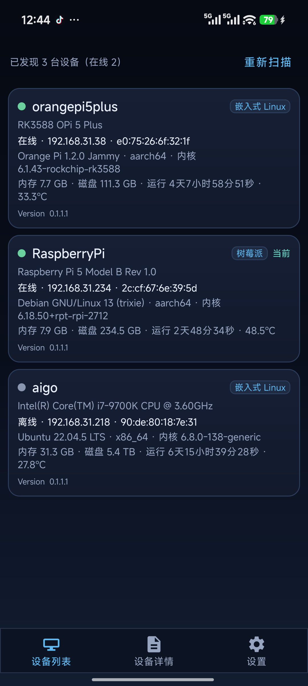
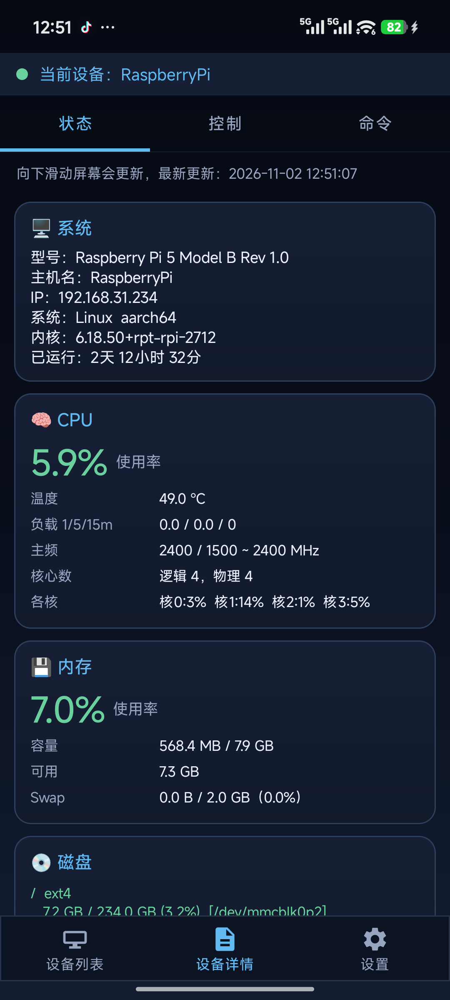
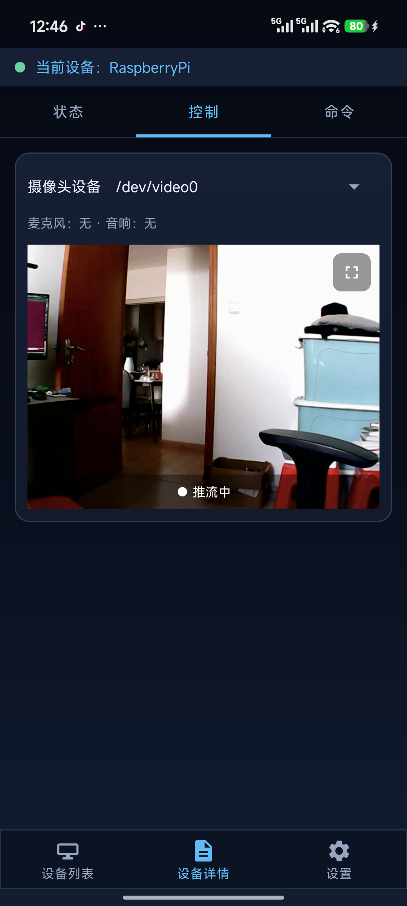
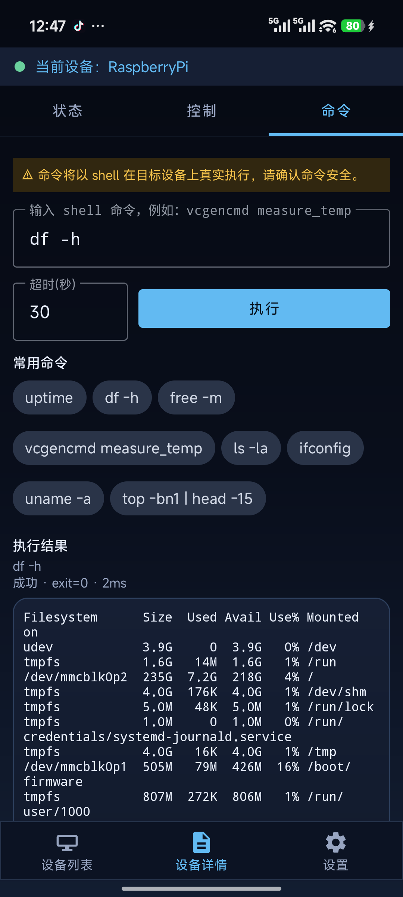
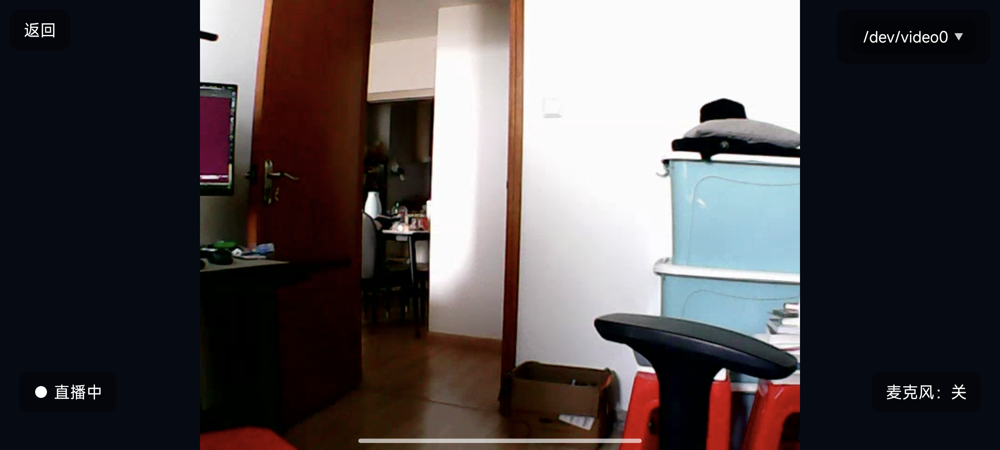
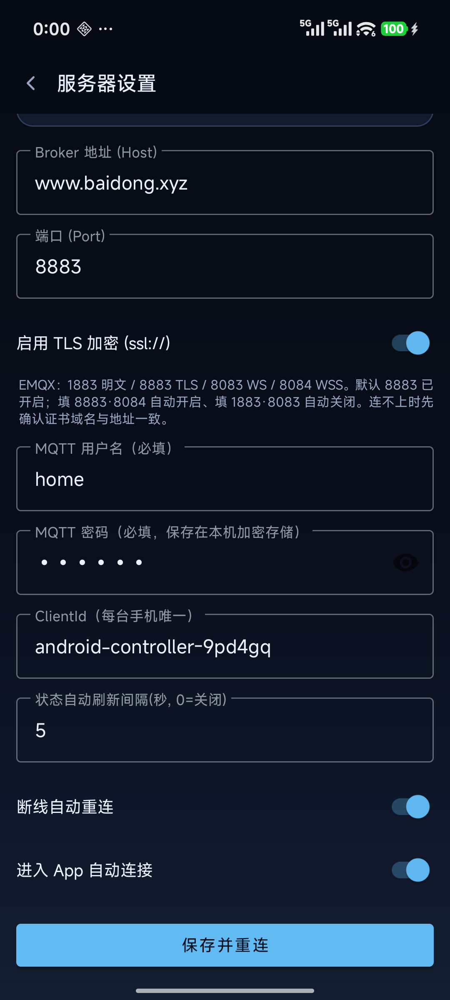

<div align="center">

# 树莓派控制器 · walle

**用手机远程监控与操控 Linux / 树莓派设备的 Android 客户端**


</div>

---

## 项目简介

`walle` 是一个基于 **MQTT** 的 Android 设备面板：手机连上 MQTT Broker 后，可以发现局域网/公网上的树莓派等 Linux 设备，实时查看 CPU、内存、磁盘、网络、温度等运行状态，接收异常告警，远程执行 shell 命令，并通过 **WebRTC（WHEP）** 观看设备端摄像头的实时画面。

App 只负责「看」和「控制」，设备端由配套的 Python 监控脚本（仓库外）负责采集与执行，两端通过一组约定好的 MQTT 主题交互。

```
┌──────────────────┐      MQTT 主题 / JSON      ┌──────────────────┐
│   Android App    │ ◄────────────────────────► │   MQTT Broker    │
│  树莓派控制器      │                            │  Mosquitto 等    │
└────────┬─────────┘                            └────────┬─────────┘
         │ WHEP over HTTPS                               │ MQTT
         ▼                                               ▼
┌──────────────────┐      RTMP / RTSP 推流      ┌──────────────────┐
│  WHEP / 流媒体服务 │ ◄───────────────────────── │ 树莓派 / Linux 设备│
│  SRS、MediaMTX 等 │                            │ main.py          │
└──────────────────┘                            └──────────────────┘
```

---

## 功能特性

| 分类 | 特性说明 |
|:-----|:---------|
| 🗂 设备管理 | 列表直接展示当前在线设备，来自设备上线retained报文，订阅即回放<br>下拉刷新/手动扫描按需广播发现请求，无设备时自动兜底<br>以uuid为主键，uuid变更时按device_id自动归并，无幽灵卡片 |
| 📊 实时状态 | 支持系统、CPU、内存、磁盘、网络全维度状态展示<br>支持手动查询+可配置间隔自动刷新，下拉刷新 |
| 🎮 视频控制 | 自动枚举设备端v4l2摄像头，展示支持的格式/分辨率/帧率<br>点击发起推流，运行中可切换摄像头避免黑屏<br>内嵌预览+全屏播放，跟随重力横屏、沉浸式、保持常亮<br>标准WHEP拉流流程 |
| ⌨️ 远程命令 | 支持shell任意命令执行，超时1-300秒可调<br>基于request_id配对结果，避免多命令串台<br>内置8条常用命令一键填入，保留20条会话历史<br>结果按状态着色区分 |
| 🔔 告警中心 | 接收设备告警、恢复、USB插拔事件<br>按级别与事件类型配色，设置tab显示未读红点<br>支持一键清空 |
| ⚙️ 连接设置 | 完整MQTT连接参数配置，保存后自动重连<br>clientId持久化避免被Broker互踢<br>前台服务保活长连接，常驻通知 |
| 🚀 首次启动引导 | 3屏全屏滑动引导，支持跳过<br>引导结束自动标记，设置页可随时重看 |


---

## 界面预览

|         设备列表          |      详情页                |            控制页              |            命令              |
|:-------------------------:|:--------------------------:|:------------------------------:|:----------------------------:|
|  |  |  |  |


|         视频监控页          |
|:-------------------------|
| |


---

## MQTT 主题约定

**协议 v1（多租户主题）**：所有主题都在 `walle/{tenant}/{device}/v1/` 下展开。

- `tenant` = App 登录用的 MQTT 用户名（清洗后），Broker 用 `walle/${username}/#` 做 ACL；
- `device` = 设备端稳定的 `device_id`（MAC + CPU + 内存的 md5 前 16 位，重启不变）；
- 所有报文均为 JSON，QoS 1，Keep Alive 60s；除发现广播外，请求必须带匹配的 `uuid`；
- `online` 为 retained：设备上线时发布（含完整身份字段），掉线由遗嘱发布 `online:false`。

请求按语义命名：查询用 `…/query`、命令用 `…/exec`、动作（推流）用 `…/request`；应答一律
`…/result` 且只在收到对应请求后发布，并原样回显 `request_id` 供 App 配对；
主动上报只有 `online` 与 `alarm`。

> **完整的报文字段定义、设计原则与修改流程见 [MQTT_protocol_convention.md](doc/MQTT_protocol_convention.md)。**
> 改主题或报文格式前请先读它。

推流成功后在 App 侧按 `room_number` 拼接 WHEP 地址拉流（`BuildConfig.WHEP_URL_TEMPLATE`）。

> 设备端实现与部署见 [`linux/README.md`](linux/README.md)。

---

## 快速上手

| 重要文档 | 介绍 |
|---|---|
| [doc/service_deploy.md](doc/service_deploy.md) | 如何部署服务器、配置证书，权限介绍|
| [doc/quick_start.md](doc/quick_start.md) | 如何编译app，连接服务器，如何使用|
| [linux/README.md](linux/README.md) | 如何部署linux设备端代码，如何使用和调试设备端代码。|


## 快速验证demo

下载demo包：[release](https://github.com/baidong/walle-android/releases)

使用adb命令安装

```
adb install walle-android-0.1.1.apk
```

测试使用的用户名为home，密码是123456，注意，当前apk未配置whipSecret(在[gradle.properties](gradle.properties)文件中)，因此不能app端发起语音通话，但是能看到视频流。

打开app后，需要先配置用户名和密码，然后点击保存连接，如图所示：




---


---

## 常见问题

**连不上 Broker？**
检查手机与设备是否在同一网络、Broker 是否监听、用户名密码是否正确；同 `clientId` 多端登录会被互相踢下线（App 会自动重连）。设置页里能看到具体失败原因（超时 / 凭据被拒 / 端口协议不匹配等）。

**设备列表为空？**
设备端需先连接同一 Broker 并保持在线。点击「重新扫描」会在本租户内广播 `walle/{tenant}/v1/discovery/query`，设备在 3 秒内回复即会出现。

**推流后黑屏？**
确认设备端已启动推流、WHEP 服务可访问、`room_number` 与 App 拼接的地址一致。切换摄像头会复用原房间号，不会新建会话。


---

## 已知限制

- MQTT 默认走 `ssl://:8883`；清单已禁止明文流量（`network_security_config`，debug 包允许用户 CA），仅当显式改用 1883 明文端口时才会以 `tcp://` 连接。
- 凭据已用 Android Keystore 加密存储；MQTT 与 WHEP 均使用系统 CA 严格校验，服务端证书需要是公共 CA 签发且 SAN 与填写域名一致。
- **不做云备份/整机迁移**（`allowBackup=false`）：换机后需要重新输入 Broker 账号密码；这是刻意的取舍，避免凭据随备份外流。
- 仓库不含设备端采集脚本与 Broker 配置，需自行部署。

---

## 相关文档

- [快速上手指南](doc/quick_start.md) — 环境要求、构建、Broker 配置、证书与权限
- [MQTT 协议约定（协议 v1）](doc/MQTT_protocol_convention.md) — 全部报文字段定义、设计原则与修改流程（改协议前必读）
- [设备端部署说明](linux/README.md) — 树莓派一键安装脚本、配置项与排障

## 许可

本项目采用 Apache License 2.0 许可证。请参阅 [LICENSE](LICENSE) 文件。
